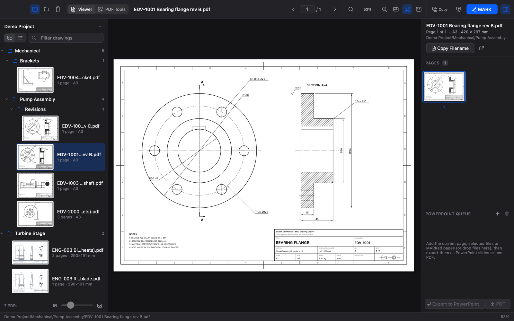
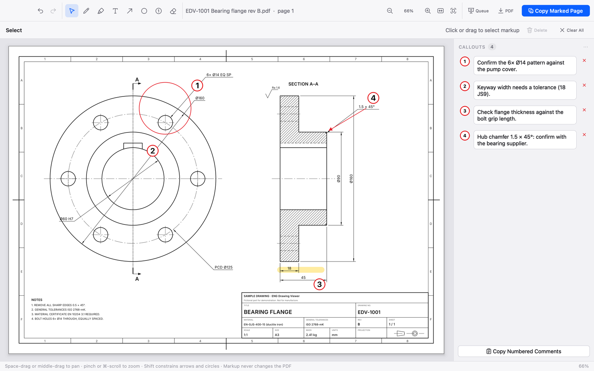
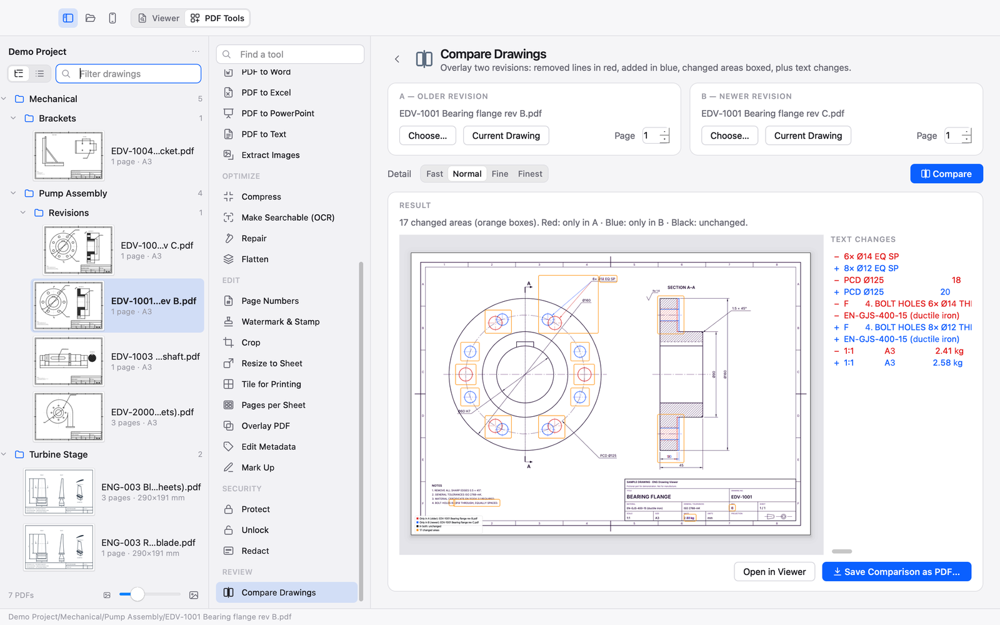

# ENG Drawing Viewer

A free, offline workspace for engineering drawings. Open folders of PDF drawings and images, view them sharply at any zoom, mark them up with numbered review comments, convert them with 32 PDF tools and turn them into PowerPoint slides, all on your own computer.

Website and downloads: **https://ca-works.github.io/eng-drw/**



## What it does

**Open anything.** Open a folder or files, or drag PDFs, images or folders onto the window. Every PDF and image in the folder's subfolders is listed in a folder tree or a flat list, sorted naturally (`Sheet 2` before `Sheet 10`), with thumbnails, page counts and sheet sizes (A0–A5, ANSI). PNG, JPEG, TIFF, WebP, BMP, GIF and, on the Mac, HEIC photos open like one-page drawings.

**View sharply.** Pages are rendered by MuPDF in tiles at your screen's exact pixel density, so text and 0.1 pt hairlines stay crisp from 1.5 % to 4800 %. Zoom with pinch or ⌘-scroll at the pointer, pan by dragging, and flip with ← → straight into the next drawing.

**Copy.** Copy a page to the clipboard as a high-resolution image (150, 220 or 300 DPI) ready to paste into a presentation, copy its filename, or save a PNG.

**MARK.** Mark up a page without touching the PDF: pen, highlighter, outline circle, arrow, text, numbered red callout bubbles and an eraser, with undo and redo. Every callout gets a numbered, spell-checked comment beside the drawing. Copy the marked page, save it as a PDF with vector markup, or send it to PowerPoint.



**PowerPoint.** Queue pages, reorder them, and export a `.pptx` without needing PowerPoint. The filename becomes an editable title, and marked pages put the drawing on the right with the numbered comments in an editable text box on the left. Export to a new deck or insert into an existing one, or export the queue as one PDF.

**PDF Tools.** 32 offline tools in seven groups: organize (a visual page organizer, merge, split, extract, remove, rotate), convert to and from PDF (images, Word, Excel, PowerPoint, text), optimize (compress, OCR, repair, flatten), edit (page numbers, watermarks and stamps, crop, resize to sheet, tile for printing, pages per sheet, overlay, metadata), secure (protect, unlock, redact) and **Compare Drawings**, which overlays two revisions with removed lines in red and added lines in blue. Results are always new files. *Office to PDF* needs LibreOffice installed. See [docs/PDF_TOOLS.md](docs/PDF_TOOLS.md).



**Scan with iPhone (Mac).** Use Apple's Continuity Camera to scan a paper drawing straight into a PDF, ready to mark up.

## Private by design

Everything runs on your computer. There is no account, no telemetry and no network access: the app blocks network connections in its own code, and the test suite checks that. PDFs are opened read-only and never changed (tests check this byte for byte), and markup stays temporary until you copy or save it.

The app keeps its settings, a thumbnail cache (which you can clear in Settings), an error log if something crashes, and scans you make with your iPhone, all in the usual folders for your system.

## Install

Download the Mac version (Apple silicon) from the website or the [releases](https://github.com/ca-works/eng-drawing-viewer/releases), open the disk image and drag the app to Applications. The app is free and not notarized by Apple, so the first time you open it, go to System Settings › Privacy & Security and click **Open Anyway**. Details: [docs/INSTALL.md](docs/INSTALL.md).

A new Windows version is in development.

## Build from source

You need an Apple silicon Mac with Xcode's command-line tools and [uv](https://docs.astral.sh/uv/).

```bash
packaging/macos/build_macos.sh
```

This creates a Python 3.13 build environment, installs the exact packages listed with hashes in `packaging/requirements-macos.txt`, runs PyInstaller, signs the app ad hoc, runs a smoke test and writes the app, a DMG and a ZIP to `release/macos/`. To work on the code:

```bash
uv venv --python 3.13 .venv
uv pip install --python .venv/bin/python --require-hashes -r packaging/requirements-macos.txt
uv pip install --python .venv/bin/python --no-deps -e .
.venv/bin/python -m eng_viewer          # run the app
.venv/bin/python -m pytest              # run the tests
```

More: [docs/BUILDING.md](docs/BUILDING.md) · [Changelog](CHANGELOG.md)

## Project layout

```
src/eng_viewer/
  app.py         entry point, startup, file-open events
  core/          rendering workers, scanning, settings, PowerPoint writer,
                 spelling, documents, PDF tools, offline guard
  ui/            main window, tiled page view, library, queue, export, About
  ui/mark/       MARK window, canvas, annotations, undo, comments
  ui/tools/      PDF Tools workspace, organizer, compare
  platform/      macOS and Windows integrations
  resources/     icons and dictionaries
tests/           pytest suite and sample-drawing generator
packaging/       PyInstaller specs, build scripts, icon generator, launcher
tools/           benchmark, word-list and release tooling
licenses/        third-party licences
```

## Licence

Copyright © 2026 ca-works.

ENG Drawing Viewer is free software: you can redistribute it and/or modify it under the terms of the GNU Affero General Public License as published by the Free Software Foundation, either version 3 of the License, or (at your option) any later version. It is distributed WITHOUT ANY WARRANTY. See [LICENSE](LICENSE).

It is built on Qt for Python (PySide6, LGPL), PyMuPDF and MuPDF (AGPL), python-pptx, python-docx, XlsxWriter, Pillow, lxml and PyObjC, and its spelling dictionary comes from SCOWL. Their licences are in [licenses/](licenses/) and in the app under Help › About.

The ENG Drawing Viewer name and icon identify this project; please don't use them for modified versions in a way that suggests they are the original.
